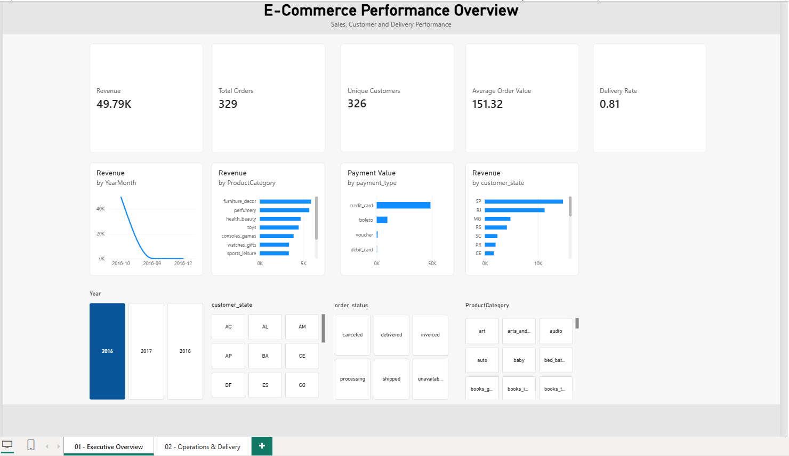
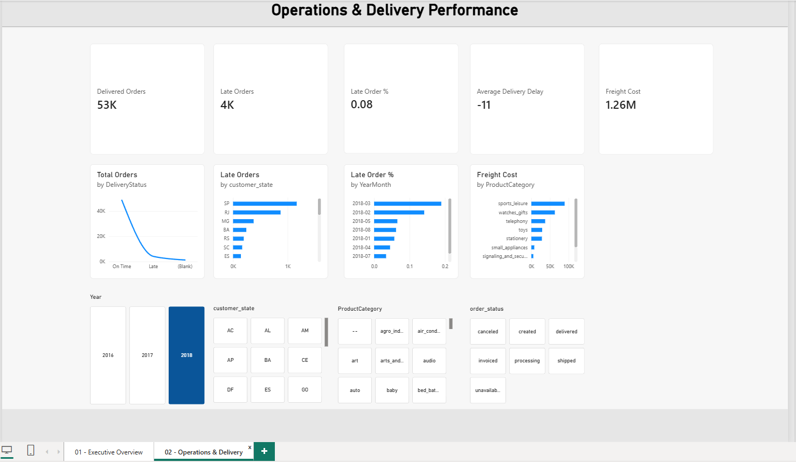
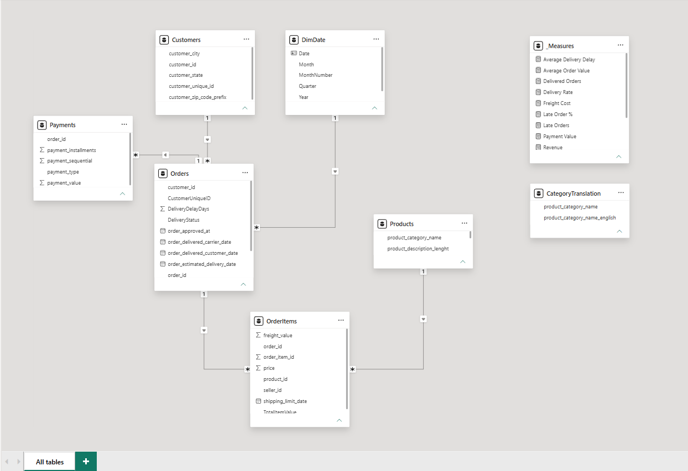

# Olist E-Commerce Analytics — Power BI Project & Practical Learning Guide

An end-to-end Power BI analytics project built on the **Olist Brazilian E-Commerce Dataset** to analyze sales performance, customer activity, product categories, payment behavior, freight costs, and delivery performance.

This repository is designed as both:

- a **portfolio project** demonstrating practical Power BI skills
- a **practical learning guide** for anyone who wants to understand how a multi-table Power BI solution is built from business questions through validation

**Dataset:** [Brazilian E-Commerce Public Dataset by Olist](https://www.kaggle.com/datasets/olistbr/brazilian-ecommerce?resource=download)

The project follows the complete Power BI workflow:

**Business Questions → Power Query → Data Modeling → DAX → Dashboard Design → Validation**

---

## Project Overview

The goal of this project was to build a structured Power BI solution from multiple related e-commerce tables rather than relying on a single flat dataset.

The analysis was designed around two main perspectives:

- **Executive Performance** — revenue, orders, customers, product categories, geographic performance, and trends
- **Operations & Delivery** — delivery performance, late orders, delays, freight costs, and order status

A major focus of the project was understanding **table grain, relationships, filter propagation, and data quality** so that KPIs remained reliable across interactive report filters.

---

## What You Will Learn

This project is useful for anyone learning Power BI because it demonstrates the full reporting workflow rather than only dashboard design.

You will see practical examples of:

- translating business questions into reporting requirements
- preparing data with Power Query
- understanding table grain
- creating one-to-many relationships
- building a multi-table data model
- using a dedicated date dimension
- creating reusable DAX measures
- understanding filter context
- using `CALCULATE`, `DISTINCTCOUNT`, and `DIVIDE`
- validating KPIs
- troubleshooting filter propagation
- avoiding unnecessary bidirectional relationships
- handling null values and duplicates correctly
- designing executive and operational dashboards

---

## Dataset

This project uses the **Brazilian E-Commerce Public Dataset by Olist**, available on Kaggle:

[https://www.kaggle.com/datasets/olistbr/brazilian-ecommerce?resource=download](https://www.kaggle.com/datasets/olistbr/brazilian-ecommerce?resource=download)

The dataset contains multiple related tables covering areas such as:

- Orders
- Order items
- Customers
- Products
- Payments
- Sellers
- Geolocation
- Product category translations

For this Power BI project, the main analytical model focuses on the tables required for sales, customer, product, payment, and delivery analysis.

Raw dataset files do not need to be included in this repository. They can be downloaded directly from the Kaggle source above.

---

## Business Questions

The dashboard was designed to answer questions such as:

- How much revenue is being generated?
- How many orders and unique customers are there?
- What is the average order value?
- Which product categories contribute the most revenue?
- Which geographic areas generate the most sales?
- How is revenue changing over time?
- What percentage of orders are successfully delivered?
- How many orders are delivered late?
- Which regions experience the most delivery issues?
- What are the major freight costs?
- How do customers use different payment methods?

---

## Dashboard Preview

### Executive Overview



### Operations & Delivery



---

## Dashboard Pages

### 1. Executive Overview

Provides a high-level view of business performance.

#### Key KPIs

- Revenue
- Total Orders
- Unique Customers
- Average Order Value
- Delivered Orders
- Delivery Rate
- Previous Month Revenue
- Revenue Growth %

#### Visual Analysis

- Revenue trend over time
- Revenue by product category
- Revenue by customer state
- Payment method analysis
- Order performance
- Interactive date, category, and geographic filters

---

### 2. Operations & Delivery

Focuses on fulfillment and logistics performance.

#### Key KPIs

- Delivered Orders
- Late Orders
- Late Order %
- Average Delivery Delay
- Freight Cost

#### Visual Analysis

- Order status distribution
- Late orders by state
- Delivery performance over time
- Freight cost by product category
- Delivery delay analysis

---

## Dataset Structure

The model uses several related tables with different levels of granularity.

| Table | Grain |
|---|---|
| `Orders` | One row per order |
| `OrderItems` | One row per item within an order |
| `Customers` | One row per customer record |
| `Products` | One row per product |
| `Payments` | One row per payment record |
| `CategoryTranslation` | Product-category translation lookup |
| `DimDate` | One row per calendar date |

Understanding the grain of each table was important to avoid duplicated values when combining data.

For example, directly joining a table containing multiple order items with a table containing multiple payments for the same order could multiply rows and inflate revenue or payment totals.

---

## Data Model

The main relationships were designed using one-to-many relationships and primarily single-direction filtering.

```text
Customers  1 ─────── * Orders
DimDate    1 ─────── * Orders
Orders     1 ─────── * OrderItems
Products   1 ─────── * OrderItems
Orders     1 ─────── * Payments
```

The model intentionally keeps tables with different grains separate instead of flattening everything into one large table.

This helps:

- reduce duplicated values
- maintain clear business grain
- keep filtering predictable
- simplify debugging
- improve measure reliability

### Data Model Diagram



---

## Power Query Data Preparation

Power Query was used to clean and prepare the data before it entered the Power BI model.

Important preparation steps included:

- correcting data types
- validating date columns
- handling null values
- checking duplicate business keys
- creating delivery-related fields
- merging product-category translations
- creating additional classification fields
- removing unnecessary columns
- preparing tables for relationships
- practicing query referencing and appending

---

## Delivery Delay Logic

A delivery-delay field was created using the difference between the actual delivery date and the estimated delivery date.

```text
Delivery Delay = Actual Delivery Date - Estimated Delivery Date
```

This was then used to classify orders as:

- On Time
- Late
- Not yet applicable / missing delivery information

Null values were not automatically removed because a missing delivery date may represent a valid business state rather than incorrect data.

---

## Merge vs Append

### Merge

Used to join tables using a matching key and add additional columns.

Example:

```text
Products + CategoryTranslation
```

The translated category name was merged into the `Products` table.

### Append

Used to stack similar datasets vertically.

Example:

```text
Orders_2017 + Orders_2018 = Combined Orders
```

---

## Reference vs Duplicate

Another useful Power Query concept demonstrated in the project is the difference between **Reference** and **Duplicate**.

### Reference

Creates a new query based on the output of another query.

Useful when multiple downstream queries should reuse the same prepared dataset.

### Duplicate

Creates an independent copy of the existing query and its current transformation steps.

---

## Data Quality Checks

Validation included:

- checking expected row counts
- verifying data types
- investigating null values
- checking duplicate keys
- validating relationship keys
- understanding table grain
- testing filters and slicers
- checking measure behavior
- comparing totals across different levels of the model

For `OrderItems`, duplicate validation was based on:

```text
order_id + order_item_id
```

Repeated `order_id` values alone are expected because a single order can contain multiple products.

A key principle used throughout the project was:

> Do not remove a duplicate or null value until its business meaning is understood.

---

## DAX Measures

A dedicated `_Measures` table was used to organize analytical measures.

### Revenue

```DAX
Revenue =
SUM(OrderItems[price])
```

### Freight Cost

```DAX
Freight Cost =
SUM(OrderItems[freight_value])
```

### Total Orders

```DAX
Total Orders =
DISTINCTCOUNT(Orders[order_id])
```

### Unique Customers

```DAX
Unique Customers =
DISTINCTCOUNT(Orders[CustomerUniqueID])
```

### Average Order Value

```DAX
Average Order Value =
DIVIDE(
    [Revenue],
    [Total Orders]
)
```

### Delivered Orders

```DAX
Delivered Orders =
CALCULATE(
    [Total Orders],
    Orders[order_status] = "delivered"
)
```

### Delivery Rate

```DAX
Delivery Rate =
DIVIDE(
    [Delivered Orders],
    [Total Orders]
)
```

### Late Orders

```DAX
Late Orders =
CALCULATE(
    [Total Orders],
    Orders[DeliveryStatus] = "Late"
)
```

### Previous Month Revenue

```DAX
Revenue Previous Month =
CALCULATE(
    [Revenue],
    DATEADD(
        DimDate[Date],
        -1,
        MONTH
    )
)
```

### Revenue Growth %

```DAX
Revenue Growth % =
DIVIDE(
    [Revenue] - [Revenue Previous Month],
    [Revenue Previous Month]
)
```

---

## Important DAX Concepts

### Measure vs Calculated Column

A **calculated column** is evaluated row by row and stored in the model.

A **measure** is dynamically evaluated based on the current filter context.

### Filter Context

Filter context is the set of filters currently affecting a calculation.

Filters can come from:

- slicers
- report filters
- visual filters
- rows and columns in a visual
- DAX expressions

### CALCULATE

`CALCULATE` evaluates an expression under a modified filter context.

Example:

```DAX
Delivered Orders =
CALCULATE(
    [Total Orders],
    Orders[order_status] = "delivered"
)
```

### SUM vs SUMX

`SUM` aggregates one numeric column directly.

`SUMX` iterates over a table and evaluates an expression for each row before summing the results.

---

## Date Dimension

A dedicated `DimDate` table was added for consistent calendar filtering and time-intelligence calculations.

Typical fields include:

- Date
- Year
- Month
- Month Number
- Quarter
- Year-Month

Relationship:

```text
DimDate[Date] 1 ───── * Orders[OrderDate]
```

Using a dedicated date dimension makes monthly trends and previous-period comparisons more reliable.

---

## Important Modeling Challenge

One of the most useful technical lessons in the project involved filter propagation.

A product slicer correctly affected the Revenue measure because the filter path was:

```text
Products
    ↓
OrderItems
    ↓
Revenue
```

However, some order-level measures did not automatically respond because the filter did not naturally propagate back to the `Orders` table.

Rather than immediately changing all relationships to bidirectional filtering, the issue was investigated by considering:

- relationship direction
- table grain
- measure location
- filter context
- model structure

This reinforced an important modeling principle:

> Prefer predictable model design over using bidirectional relationships as a quick fix.

---

## Power Query vs DAX

> **Power Query prepares the data. DAX analyzes the data.**

Stable transformations such as cleaning, merging, classifications, and data-type changes were handled primarily in Power Query.

Dynamic calculations that needed to respond to report filters were implemented as DAX measures.

---

## Troubleshooting Framework

When a KPI does not look correct, the project follows a structured troubleshooting approach:

```text
Source
↓
Power Query
↓
Data Quality
↓
Table Grain
↓
Relationships
↓
Filter Direction
↓
DAX
↓
Visual
↓
Business Definition
```

This prevents jumping directly to DAX when the underlying issue may actually be caused by source data, transformation logic, or model design.

---

## Validation Approach

The report was validated by checking:

- slicer behavior
- relationship behavior
- KPI totals
- filter propagation
- duplicate handling
- business logic
- date filtering
- source consistency

A dashboard was not considered complete simply because the visuals looked correct. The underlying data model and measures also had to behave consistently.

---

## Project Structure

```text
olist-ecommerce-powerbi-analytics/
│
├── README.md
│
├── dashboard/
│   └── olist_ecommerce_analytics.pbix
│
├── screenshots/
│   ├── executive_overview.png
│   └── operations_delivery.png
│
├── docs/
│   └── data_model.png
│
└── data/
    └── README.md
```

### Do I need two README files?

No. The **main `README.md` at the repository root is the only full README you need**.

The optional `data/README.md` should only be a very small note explaining:

- where to download the Olist dataset
- why raw data files are not stored in the repository
- which source files are required

It should **not duplicate this full README**.

If you want the simplest possible repository, you can also remove the `data/` folder entirely and keep only this root `README.md`, because the Kaggle dataset link is already included above.

---

## Recommended Repository Structure

For a clean portfolio repository, I recommend:

```text
olist-ecommerce-powerbi-analytics/
│
├── README.md
│
├── dashboard/
│   └── olist_ecommerce_analytics.pbix
│
├── screenshots/
│   ├── executive_overview.png
│   └── operations_delivery.png
│
└── docs/
    └── data_model.png
```

This is enough for a professional GitHub portfolio project.

---

## How to Use This Project

1. Download the dataset from Kaggle:
   [Brazilian E-Commerce Public Dataset by Olist](https://www.kaggle.com/datasets/olistbr/brazilian-ecommerce?resource=download)

2. Download or clone this repository.

3. Open:

```text
dashboard/olist_ecommerce_analytics.pbix
```

4. If Power BI cannot find the source files, update the data-source paths in Power Query.

5. Refresh the model.

6. Explore the Executive Overview and Operations & Delivery pages.

---

## Tools & Technologies

| Area | Tools |
|---|---|
| Business Intelligence | Power BI |
| Data Preparation | Power Query |
| Data Modeling | Power BI Data Model |
| Calculations | DAX |
| Data Validation | Power Query / Power BI |
| Version Control | Git / GitHub |

---

## Skills Demonstrated

- Power BI dashboard development
- business requirement translation
- Power Query
- ETL
- multi-table data modeling
- table grain analysis
- fact and dimension modeling
- one-to-many relationships
- filter propagation
- DAX measures
- filter context
- `CALCULATE`
- `DISTINCTCOUNT`
- `DIVIDE`
- time intelligence
- KPI development
- data quality validation
- troubleshooting
- dashboard design
- business-focused reporting

---

## Key Lessons

1. Business questions should define the report before visualizations are created.
2. Table grain must be understood before defining relationships.
3. Tables with different grains should not automatically be flattened.
4. Power Query is best suited for stable data preparation.
5. DAX measures should be used for calculations that respond dynamically to report filters.
6. Relationship direction directly affects filter behavior.
7. Bidirectional filtering should have a clear modeling reason.
8. A dedicated date dimension improves time-based analysis.
9. KPI definitions should be validated from both a technical and business perspective.
10. A dashboard is not complete until filters, relationships, and important totals have been validated.

---

## Future Improvements

Potential next steps include:

- additional customer segmentation
- profitability analysis
- more advanced delivery KPIs
- drill-through pages
- automated source-to-report validation
- Power BI Service deployment
- scheduled refresh
- row-level security
- additional performance optimization

---

## CV Project Name

For a concise CV entry, this project can be listed as:

**Olist E-Commerce Analytics — Power BI Project**

Recommended technology line:

`Power BI · Power Query · DAX · Data Modeling · Data Quality`

---

## Author

**Mubashir Mubashir**

M.Sc. High Integrity Systems  
Frankfurt University of Applied Sciences

Focus areas:

`Power BI` · `Power Query` · `DAX` · `Python` · `SQL` · `Data Engineering` · `Process Automation`
